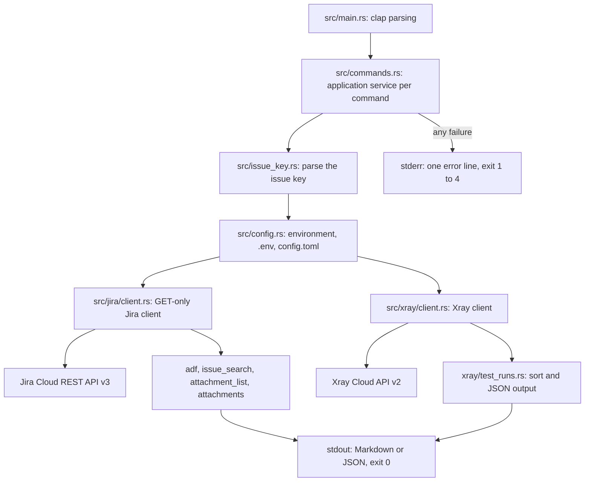
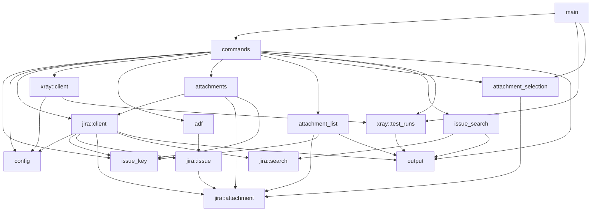

# Architecture

jcli is a small Rust CLI that reads Jira Cloud for coding agents. It prints an
issue as Markdown, searches issues with JQL, downloads an issue's attachments and
lists the test runs Xray Cloud stores for a Test or Test Execution issue. It never changes data in
Jira or Xray. The binary is built with the stable toolchain and blocking reqwest,
without an async runtime ([ADR 0002](adr/0002-build-jcli-as-a-single-rust-binary.md)).

## Commands

| Command | Output on stdout |
| --- | --- |
| `jcli issue read <KEY>` | The issue as Markdown |
| `jcli issue search --jql <JQL> --json [--limit N]` | The first page of matching issues as JSON |
| `jcli issue attachments list <KEY> --json [--name GLOB]... [--id ID]...` | The issue's attachment metadata as JSON |
| `jcli issue attachments download <KEY> [--out DIR] [--name GLOB]... [--id ID]...` | A Markdown list of the downloaded files |
| `jcli xray test-runs <KEY> --json [--status S]... [--sort started-on] [--direction asc\|desc]` | The first page of test runs of a Test or Test Execution issue as JSON |
| `jcli whoami` | The account the credentials belong to, on one line |

`<KEY>` is a canonical issue key such as `ABC-123`: a project part of 2 to 10
uppercase ASCII letters or digits that starts with a letter, a hyphen, and a
positive number without leading zeros. URLs and bare numbers are rejected.

## Runtime flow



`src/main.rs` declares the commands with clap's derive API and hands each one to a
function in `src/commands.rs`. Clap rejects unknown commands, missing required
flags, out-of-range values such as `--limit 0` and invalid `--name` globs before
jcli reads any configuration, and exits with code 2.

Each `pub(crate)` function in `src/commands.rs` is the application service for one
command. It runs the same steps in order:

1. Parse the issue key, if the command takes one. A malformed key exits 1 before
   jcli loads configuration.
2. Load the configuration. `xray test-runs` also loads the Xray configuration
   before it sends any request, so a missing Xray setting fails without network
   traffic.
3. Build the client and send the requests.
4. Render the complete result and write it to stdout in one call, then exit 0.

Every application service ends the process itself and returns `!`. A failure at any step
prints `error: <message>` on stderr and exits with the step's code. stdout stays
empty on failure.

| Exit code | Cause |
| --- | --- |
| 0 | Success |
| 1 | Invalid issue key |
| 2 | Configuration error, or a usage error reported by clap |
| 3 | Jira or Xray request failure, a Jira response jcli refuses to use, or an issue that is not an Xray Test or Test Execution |
| 4 | Filesystem failure, unsupported platform for attachments, or a failed stdout write |

`xray test-runs` resolves the issue key to Jira's numeric issue ID and issue type
with one Jira request. A `Test` or `Test Execution` issue goes on to Xray with the
matching filter. Any other or missing type exits 3 before jcli sends an Xray
request ([ADR 0011](adr/0011-xray-issue-kinds.md)). `issue attachments download`
checks for Unix before it loads the configuration and exits 4 on other platforms.
`issue attachments list` runs on every platform.

## Modules and dependencies

jcli has one bounded context: reading Jira issues and their Xray test runs for an
agent. The ubiquitous language uses Jira's terms: `issue`, `issue key`,
`attachment`, `JQL` and `test run`, plus Xray's issue kinds `Test` and
`Test Execution`.

- `src/main.rs`: the clap command tree and dispatch.
- `src/commands.rs`: the application services, one function per command, plus
  exit handling. It wires all other modules together.
- `src/issue_key.rs`: `IssueKey`, a value object that only exists in canonical
  form. Its parse error never echoes the input.
- `src/config.rs`: `Config` for Jira and `XrayConfig` for Xray, resolved from the
  process environment, the `.env` in the working directory and the per-user
  `config.toml`. It owns `SanitizedUrl`, which the `Debug` output of `Config`,
  `XrayConfig` and `XrayClient` uses.
- `src/jira/`: the Jira side of the anti-corruption layer. `client.rs` is the
  GET-only HTTP client with status mapping, body limits and JQL error redaction.
  `issue.rs`, `attachment.rs` and `search.rs` are serde models that deserialize
  only the fields jcli requests. Jira's names such as `issuetype` and `isLast`
  stop at their serde attributes. `issue.rs` also holds `IssueReference`, the
  value object with the numeric ID and issue type name that `xray test-runs`
  needs.
- `src/xray/`: the Xray side. `client.rs` exchanges the API key for a bearer token
  and runs the `getTestRuns` GraphQL query with the filter for the issue kind.
  `test_runs.rs` holds `XrayIssueKind`, the response models, the page sort and
  the `TestRunsOutput` JSON contract.
- `src/adf/`: translates Jira's Atlassian Document Format (ADF) into Markdown and
  renders the issue page for `issue read`
  ([ADR 0008](adr/0008-hand-rolled-adf-to-markdown-renderer.md)).
- `src/issue_search.rs`: maps a Jira search page to the `IssueSearchOutput` JSON
  contract.
- `src/attachment_list.rs`: maps attachment metadata to the
  `AttachmentListOutput` JSON contract.
- `src/attachment_selection.rs`: `AttachmentSelection`, a value object holding
  the `--name` globs and `--id` values. Its `select` method is the domain logic
  that picks the attachments `list` and `download` work on.
- `src/attachments.rs`: plans and checks attachment downloads, builds safe file
  names, and streams and writes each file
  ([ADR 0009](adr/0009-attachment-downloads.md)).
- `src/output.rs`: shared output rules: escaped pretty JSON and single-line,
  control-free terminal fields.

There is no separate domain model between the Jira response and the output. The
serde models in `src/jira/` and `src/xray/` hold only the requested fields, and
`adf`, `issue_search`, `attachment_list` and `xray::test_runs` turn them straight into the output
contract. That translation is where Jira and Xray shapes end. The one exception
is `xray test-runs`: `XrayIssueKind` turns the type name from `IssueReference`
into `Test` or `TestExecution`, which picks the Xray filter.

Arrows show the imports that exist between modules.



`config`, `issue_key` and `output` import no other jcli module. The Jira and Xray
clients do not know about each other; only `commands` combines them. All modules
are private to the binary crate, and Rust's module privacy is the only boundary
check ([ADR 0004](adr/0004-quality-gates.md)).

## Configuration

jcli reads six settings. The Jira settings are required by every command, the
Xray settings only by `xray test-runs`.

| Environment variable | `config.toml` key |
| --- | --- |
| `JIRA_BASE_URL` | `base_url` |
| `JIRA_EMAIL` | `email` |
| `JIRA_API_TOKEN` | `api_token` |
| `XRAY_BASE_URL` | `xray_base_url` |
| `XRAY_CLIENT_ID` | `xray_client_id` |
| `XRAY_CLIENT_SECRET` | `xray_client_secret` |

Precedence is per setting: the process environment, then the `.env` file in the
current working directory, then the per-user `config.toml`
([ADR 0006](adr/0006-configuration-sources-and-precedence.md)).

- The `.env` is read from the working directory only, with no search in parent
  directories. jcli parses it with dotenvy without changing the process
  environment. A leading UTF-8 byte order mark is skipped, and a duplicate key
  keeps its first value.
- The TOML file is `$XDG_CONFIG_HOME/jcli/config.toml` when `XDG_CONFIG_HOME` is
  set, non-empty and absolute, otherwise `~/.config/jcli/config.toml` when `HOME`
  is absolute. There is no system-wide file. Unknown keys are an error.
- A value that is present in a higher source wins even when it is blank or, in the
  environment, not valid Unicode. That setting then fails as `configuration value <NAME> is set
  but empty`; it never falls through to a lower source. Only an absent value falls
  through, and a setting absent everywhere fails as `missing configuration value
  <NAME>`.
- Both files are read on every load, so an unreadable or malformed file fails the
  command even when the environment supplies every setting. A `.env` or TOML file
  that is not valid UTF-8 fails as a whole. File errors are generic and never show
  the file's contents.
- A base URL only has to parse as a URL. jcli appends a trailing slash so API
  paths join onto any path prefix, and drops the query and fragment when it
  builds request URLs.

Following the trust model in `AGENTS.md`, jcli does not cap file sizes, check
permissions or reject symlinks for these files
([ADR 0003](adr/0003-keep-the-tool-small-and-trust-local-input.md)).

## Jira and Xray requests

### Jira

`JiraClient` sends only GET requests, with Basic authentication from `JIRA_EMAIL`
and `JIRA_API_TOKEN` and the user agent `jcli/<version>`
([ADR 0005](adr/0005-read-only-get-only-http-layer.md)). It keeps two reqwest
clients:

- The JSON client follows redirects only to the same scheme, host and port, for
  at most 9 redirects. A redirect to another origin is not followed, and the redirect
  status becomes a `Jira API error`.
- The attachment client follows no redirects, so credentials never leave the
  configured origin. It asks Jira for `redirect=false` and accepts only status 200.

Both use a 10 second connect timeout and a 30 second request timeout. reqwest's
blocking client applies the request timeout to sending the request and receiving
the headers, then to each read on a streamed body. For attachments it is an idle
timeout: a large video keeps downloading while data arrives.

| Command | Request |
| --- | --- |
| `whoami` | `GET rest/api/3/myself` |
| `issue read` | `GET rest/api/3/issue/{key}?fields=summary,issuetype,status,assignee,reporter,labels,created,description,attachment` |
| `issue search` | `GET rest/api/3/search/jql?jql=...&maxResults=N&fields=summary,status,issuetype,created,updated,labels` |
| `issue attachments list` | `GET rest/api/3/issue/{key}?fields=attachment` |
| `issue attachments download` | `GET rest/api/3/issue/{key}?fields=attachment`, then `GET rest/api/3/attachment/content/{id}?redirect=false` per attachment |
| `xray test-runs` | `GET rest/api/3/issue/{key}?fields=issuetype` for the numeric issue ID and the issue type |

jcli builds every URL from the configured base URL. It ignores the resource URLs
in Jira's responses, and appends the issue key and attachment ID as single encoded
path segments.

Issue, search and attachment metadata responses are read into memory up to
16 MiB; a larger body fails without truncation. `whoami` reads its small response
without that limit.

Status codes map to fixed messages: 401 names `JIRA_EMAIL` and `JIRA_API_TOKEN`,
403 is a permission error, 404 names the resource, 429 asks to retry later, and
anything else reports only the HTTP status. Error messages never contain response
bodies, with one exception. A 400 from the search endpoint reads Jira's
`errorMessages` and `errors` from a body of at most 64 KiB and joins them into one
line: `invalid JQL query (400): ...`. Each message is reduced to one terminal-safe
line, and field errors with a blank message are dropped. The API token and the
Basic authorization value, with and without the `Basic ` prefix, become
`[REDACTED]`. The email stays, because JQL errors quote it. Without a usable
message the error falls back to the generic HTTP 400.

### Xray

Xray Cloud authenticates and queries over POST, so `XrayClient` cannot be GET-only.
It sends two requests per `xray test-runs` call, and neither changes Xray data:

1. `POST api/v2/authenticate` with the client ID and secret. Xray answers with a
   bearer token as a bare JSON string, read up to 64 KiB. The token lives only
   for this call.
2. `POST api/v2/graphql` with the bearer token and the `getTestRuns` query for the
   numeric issue ID. A Test sends the ID as `testIssueIds`, a Test Execution as
   `testExecIssueIds`; each kind has its own query text. `limit` is 100 and
   `start` is 0. `--status` values travel as a GraphQL variable, never as query
   text. The response is read up to 16 MiB.

The Xray client follows no redirects, because both requests carry credentials. It
uses the same 10 second connect and 30 second request timeouts. Status codes map
like the Jira ones. A GraphQL `errors` array in a 200 response becomes the generic
`Xray GraphQL query failed`; the server's message is discarded because it may echo
input. reqwest errors have their URL removed before jcli stores them.

## Output

Output is written for agents ([ADR 0007](adr/0007-output-for-agents.md)).
Results go to stdout as Markdown or JSON with no colors or progress. Once the arguments
parse, errors go to stderr as one `error: ` line and the exit code is non-zero.
Invalid arguments get clap's multi-line usage message and exit 2.

`issue read` prints:

```text
# ABC-123: <summary>

- Type: <issue type or Unknown>
- Status: <status>
- Assignee: <display name, Unassigned or Unknown>
- Reporter: <display name or Unknown>
- Created: <timestamp as Jira returns it, or Unknown>
- Labels: <comma-separated or None>
- Attachments: <count>

## Description

<ADF rendered as Markdown, or No description.>
```

Metadata values are reduced to one line, have control and bidirectional
formatting characters removed and have Markdown characters escaped. The ADF
renderer handles paragraphs, headings, bullet and ordered lists, code blocks,
blockquotes, hard breaks and the `strong`, `em`, `code` and `link` marks. Links
render only for absolute `http` and `https` URLs. For an unknown node it renders
the text and known child content it can find instead of failing the issue.
Comments are not rendered.

`issue search` prints pretty JSON with `jql`, `returned`, `truncated` and
`issues`. `truncated` is `!isLast`, or null when Jira omits `isLast`. Each issue
has `key`, `issueType`, `status`, `summary`, `created`, `updated` and `labels`.
Missing values stay null, except `labels`, which becomes `[]`. Issues keep Jira's
order, so sorting is done with `ORDER BY` in the JQL. jcli passes the JQL to Jira
unchanged and fetches only the first page; `--limit` defaults to 20 and accepts 1
to 100. An empty result exits 0 with `"issues": []`.

`xray test-runs` prints pretty JSON with `issueKey`, `issueKind`, `total`,
`returned`, `truncated`, `start`, `limit` and `runs`. `issueKind` is `test` or
`testExecution` and names the filter that was queried, so an empty `runs` list
means the key has no runs. Each run has `id`, `status`,
`startedOn`, `finishedOn` and `testExecutionIssueId`; a null entry from Xray stays
null. `truncated` is `total > returned`, or null without a total. `--sort
started-on` reorders only the returned page, newest first unless `--direction asc`
is given. Runs with a missing or unparseable `startedOn` come after dated runs,
and null entries come last. Ties break by run ID, then by original position.

`issue attachments list` prints pretty JSON with `issue`, `returned` and
`attachments` ([ADR 0010](adr/0010-list-and-select-attachments.md)). Each
attachment has `id`, `filename`, `size`, `created` and `mimeType`, in Jira's
order. `filename` is Jira's name, not the sanitized name `download` writes.
Missing `created` and `mimeType` values are null. An issue without attachments,
or filters that match none, exits 0 with `"attachments": []`.

All JSON outputs escape DEL, the C1 control range and bidirectional formatting
characters as `\uXXXX`, so parsing the JSON returns the original text.

`issue attachments download` prints `# <KEY> attachments` followed by one `- <file name>`
line per downloaded file, or `No attachments.` when the issue has no attachments
or the filters match none. In the second case it creates no directory.

`whoami` prints `<display name> <<email>> (<account ID>)` with placeholders for
missing values.

## Attachment selection

`list` and `download` accept `--name <GLOB>` and `--id <ID>`, each repeatable
([ADR 0010](adr/0010-list-and-select-attachments.md)). An attachment is selected
when its ID equals any `--id` or its filename matches any `--name`; without
filters every attachment is selected, in Jira's order. `--name` matches Jira's
original filename, not the sanitized file name on disk, and is case-sensitive.
The `globset` crate parses and matches the globs. clap parses them, so an invalid
glob exits 2 before jcli loads configuration.

## Attachment downloads

`issue attachments download` writes into `./<KEY>/`, or into the directory given with
`--out`, which jcli uses as is. It plans every selected download before the first
download and rejects the whole selection when:

- an attachment ID is empty, longer than 256 bytes, `.` or `..`, or repeated,
- a size is negative or larger than 20 GiB,
- the selection has more than 1,000 attachments or more than 100 GiB in total,
- two generated file names are equal when compared case-insensitively.

A file name is `<id>-<filename>`, at most 240 bytes. A numeric ID of up to 48
bytes stays as is; other IDs become `id-<hex>` or, when longer than 48 bytes,
`id-sha256-<hash>`. The filename keeps ASCII letters, digits, `.` and `-`, and
collapses every other run of characters to one `-`. Leading and trailing dots and
hyphens are trimmed, an empty result becomes `attachment`, and Windows device
names such as `CON` get a `file-` prefix.

jcli creates the output directory with mode `0700` when it is missing. It then
downloads attachments one at a time in Jira's order. Each download streams into a
temporary `.jcli-attachment-*` file in that directory, which only the owner can
read. The byte count must match the size in Jira's metadata exactly. A verified
file then atomically replaces its final name. If a later attachment fails, the
files already replaced stay, the failed temporary file is removed and stdout stays
empty ([ADR 0009](adr/0009-attachment-downloads.md)).

## Credentials

Credentials never reach output. `Config`, `XrayConfig` and `XrayClient` implement
`Debug` by hand and print only a URL without user info, query or fragment. Error
messages name settings, not values. The only Jira text that reaches an error is the
JQL error described above, with credentials redacted. Xray GraphQL messages are
dropped.

## Tests and quality gates

Unit tests live next to the code in `#[cfg(test)]` modules. They cover parsers,
the ADF renderer per node type, configuration precedence through a testable
`from_sources` function, download planning and file naming. Client tests use
`httpmock` to check the exact requests, authentication headers, status mapping and
body limits. Timeout tests start raw `TcpListener` servers that stall headers or
bodies, or that keep sending data past the request timeout.

The CLI tests in `tests/` are black-box tests. `tests/common/mod.rs` runs the
built `jcli` binary with a cleared environment, in a fresh temporary directory or
one the test provides. Tests that reach Jira or Xray start their own `httpmock`
server, and the tests assert only on stdout, stderr, exit codes and written
files.

The gates ([ADR 0004](adr/0004-quality-gates.md)):

- `cargo fmt --check`, also run by the `.githooks/pre-commit` hook.
- `cargo clippy --all-targets -- -D warnings`. `Cargo.toml` also denies the whole
  `clippy::all` group.
- `cargo test`.
- `cargo llvm-cov` for coverage and `cargo crap` for the CRAP score, with the
  threshold in `.cargo-crap.toml`.
- `cargo machete` for unused dependencies.
- `cargo mutants`. Pull requests check the mutants in their diff against the base
  branch; pushes to `main` and manual runs check the full suite in four shards.
  `.cargo/mutants.toml` sets a minimum test timeout of 20 seconds for the
  timeout tests.

CI runs the gates in jobs; `fmt` and `clippy` share the Lint job. The `ci-success`
job fails if any job failed or was cancelled, and a ruleset on `main` requires it.

The [ADR index](adr/README.md) records the decisions behind these rules.
