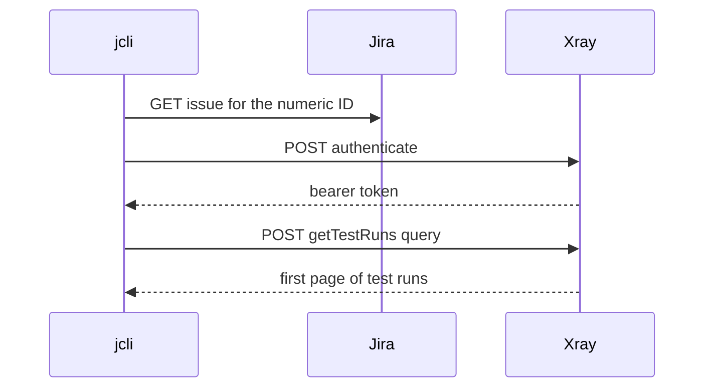

# Pull request visuals

Pick the smallest view that makes the key point clear. Most PRs need one visual, some need two, and none needs every type below. Keep only the calls, files, modules, states, and boundaries the reviewer needs to follow the change, and place each visual next to the short text it supports.

The visual types and examples below are adapted from the `show-me` skill by [Dex Horthy](https://github.com/dexhorthy) ([HumanLayer](https://github.com/humanlayer/humanlayer)), via the `pr` skill in [mattpocock/skills](https://github.com/mattpocock/skills).

## Pseudocode

Use for logic or an algorithm.

```text
for each attachment in Jira's order
  stream content into a temporary file
  if byte count != metadata size
    remove the temporary file and fail
  replace the final file name
```

## Call tree

Use for runtime control flow.

```text
commands::xray_test_runs
  Config::load
  XrayConfig::load
  JiraClient::issue_id
  XrayClient::test_runs
    authenticate
    get_test_runs
  sort_page
```

## File tree

Use for file responsibilities or a broad refactor. Keep it shallow.

```text
src/
├── commands.rs     # one application service per command
├── jira/           # Jira client and response models
└── xray/           # Xray client, test run models and output
```

## Mermaid diagram

Use for interaction between modules or services, control flow, or data flow. GitHub renders `mermaid` code blocks as diagrams.



## Diff sketch

Use a `diff` block when the point is what changes and the surrounding shape already exists. Give the diff the shape of the topic: a file tree, a call tree, control flow, or an output contract.

A file layout change:

```diff
 src/
 ├── jira/
 │   ├── client.rs
+│   ├── comment.rs       # comment response models
 │   └── issue.rs
 └── adf/
```

A call tree change:

```diff
 commands::read_issue
   JiraClient::issue
+  JiraClient::comments
   adf::render_issue
```

A control flow change:

```diff
 search_issues
   send GET search/jql
-  if status is 400
-    fail with HTTP 400
+  if status is 400
+    read Jira's error messages
+    redact credentials
+    fail with one-line JQL error
```

An output contract change:

```diff
 {
   "key": "ABC-1",
   "status": "Open",
+  "assignee": "Jane Doe",
   "labels": []
 }
```

## Whole code block

Show the whole block when most of it is new, when leaving out context would hide ownership or order, or when the reviewer needs the exact target shape.

```rust
fn attachment_exit_code(error: &attachments::AttachmentError) -> i32 {
    if error.is_filesystem() { 4 } else { 3 }
}
```
